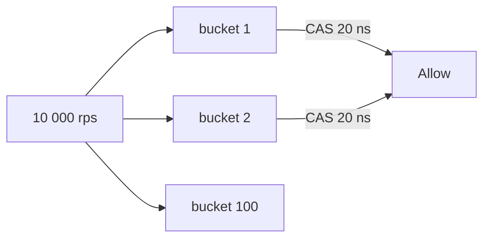

# Concurrency fundamentals

[Back](../../README.md)

## Why

One process can share memory with many threads; multiple processes cannot. An API, queue, database, cache, or distributed service multiplies these choices: requests interleave, operations may fail halfway, and clients retry.

Concurrency is the discipline of reasoning about interleavings. It matters first in a single service, then across processes, and finally across machines.

## How

Start with a state transition. A counter increases from `c` to `c + 1` only when that transition obeys the business rule.

```text
Read c → compute c + 1 → write c + 1
```

The same three operations executed by two workers may interleave:

```text
W1 read 10
W2 read 10
W2 write 11
W1 write 11   ← lost update
```

To preserve `c_new = c_old + requested_amount`, protect the critical section or make the transition explicit. The critical section must be small, well bounded, and never hold across network calls when avoidable.

## Under the hood

- **Mutual exclusion** guarantees that two operations do not enter a critical section at the same time.
- **Atomic operations** make a read-modify-write indivisible at the hardware or runtime level.
- **Queues** serialize concurrent requests.
- **Transactions** group several state changes and commit only if all conditions hold.
- **Locks** serialize access to a resource. Each lock has an owner, scope, and release policy.
- **State machines** make valid transitions explicit; every concurrent path must respect them.

Use the smallest tool that protects the invariant.

| Tool | Protects | Cost |
|---|---|---|
| Atomic counter | read-modify-write of one field | CPU contention under high write rate |
| Mutex | multi-step critical section | blocking, priority inversion, deadlocks |
| Queue | serialization of work | back-pressure and ordering policy needed |
| Transaction | multi-row/multi-record state | lock or version conflicts, isolation choice |
| Distributed lock | shared resource across processes | lease expiry, fencing, clock sensitivity |

## Production use cases

- Rate limiter with a token bucket.
- Web session cache with read-modify-write.
- Job runner that must run one worker per key at a time.
- Counter service that records distinct request attributes.
- Inventory service under burst load.

## Trade-offs and failure modes

| Choice | Gains | Costs | Failure to watch |
|---|---|---|---|
| Atomic counter | simple, lock-free | contention under high write rate | cache-line ping-pong |
| Mutex | clear critical sections | blocking, priority inversion, deadlocks | a held lock leaks |
| Message queue | decouples and buffers work | duplicates and ordering complexity | unbounded queue |
| Distributed lock | one process at a time | lease expiry and fencing complexity | silent lock takeover |

## Observability

Track queue age, lock wait time, retry count, p50/p95/p99 request latency, and worker idle versus blocked. For any shared counter, log the invariant check after each commit.

## Lab

Create a shared counter with 8 threads. Increment 100,000 times with three strategies:

1. Unsafe `c += 1`
2. Atomic `c.fetch_add(1)`
3. Mutex-protected critical section

Measure final value, p50/p95 latency, and CPU. Explain the lost updates.

## Worked examples

**Situation: rate limiter with 10,000 rps, 100 buckets.**
Each bucket is a token-bucket counter. 10,000 rps spread across 100 buckets = 100 rps/bucket. With an atomic counter per bucket, contention per bucket is `100 × ~20 ns CAS = 2 µs` — well under the 10 ms request SLO. With a global mutex, one bucket takes `10,000 × 20 ns = 200 µs` serialized. The global mutex becomes the ceiling: `1 / 200 µs = 5,000 max rps`. Sharding to 100 buckets raises the ceiling to `100 / 200 µs = 500,000 rps`.



**Situation: 8 threads, 100,000 increments.**
Unsafe: final value is less than 200,000 because each thread's read-modify-write overlaps. With a mutex: 200,000, but 8 × 100,000 = 800,000 lock acquires. Throughput on a modern CPU: ~10M mutex acquires/second, so 800,000 × ~100 ns = 80 ms. An atomic: 200,000 × ~5 ns (cache line already hot) ≈ 1 ms. The atomic is ~80× faster in the uncontended case; the mutex is safer when the critical section is multi-step.

## How to use this topic

Use the sequence: [basics](basics.md) for the worked example, [information](information.md) for production reference, and [mechanism lesson](learn/01-mechanism.md) for a guided exercise. Every design decision should trace back to the invariant and a measured failure mode.
