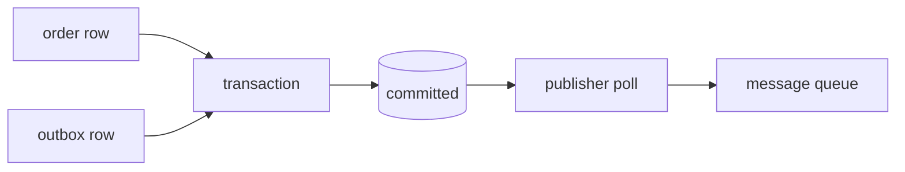

# Database transactions

[Back](../../README.md)

## Why

A database transaction is useful only when its boundary matches a business invariant. Putting unrelated work into one transaction increases lock duration and makes every participant share the database's failure domain.

## How

Define the transaction around durable state:

```text
validate input
BEGIN
  lock or version-check rows
  apply all state changes
  record an outbox event
COMMIT
publish event asynchronously
```

The outbox row is committed with the business state. A separate publisher retries delivery. This avoids the dual-write gap where the database commits but the message publish fails.

## Under the hood

A transaction context tracks its read set, write set, locks or snapshot, and commit sequence. On commit the engine validates conflicts, persists WAL records, and makes a commit marker visible. Readers use visibility rules to decide which row version they may observe.

Keep external calls outside the transaction. If a payment provider call must participate, use a state machine and compensation rather than holding a database lock while waiting on the network.

## Production use cases

- Order state + outbox event.
- User registration + unique identity record.
- Reservation + audit record.
- Schema migration metadata.

## Senior decisions

Ask whether the invariant crosses a service boundary. If yes, either move the invariant to one owner, use an explicit distributed protocol, or accept an eventually consistent workflow with reconciliation. Do not call a multi-service sequence "one transaction" because it has one request ID.

## Lab

Implement an order insert and outbox row in one transaction. Force publisher failures. Verify that restarting the publisher eventually emits every committed event exactly once to the consumer's idempotent handler.

## Worked examples

**Situation: order service, 500 orders/second, outbox pattern.**
Each order transaction writes 1 order row + 1 outbox row. At 500/second, the outbox publisher must drain 500 rows/second. With a 100 ms poll interval and 50 ms delivery per batch, the publisher can drain `500 × 0.1s / (0.1s + 0.05s) ≈ 333 rows/second`. The outbox lags by 167 rows/second — after 60 seconds, the lag is ~10,000 rows. Fix: increase batch size to 1,000 rows and poll every 50 ms. Now drain rate = `1,000 × (0.05s / (0.05s + 0.05s)) = 1,000 rows/second`, matching arrival.



## How to use this topic

Use the sequence: [basics](basics.md) for the worked example, [information](information.md) for production reference, and [mechanism lesson](learn/01-mechanism.md) for a guided exercise. Every design decision should trace back to the invariant and a measured failure mode.
