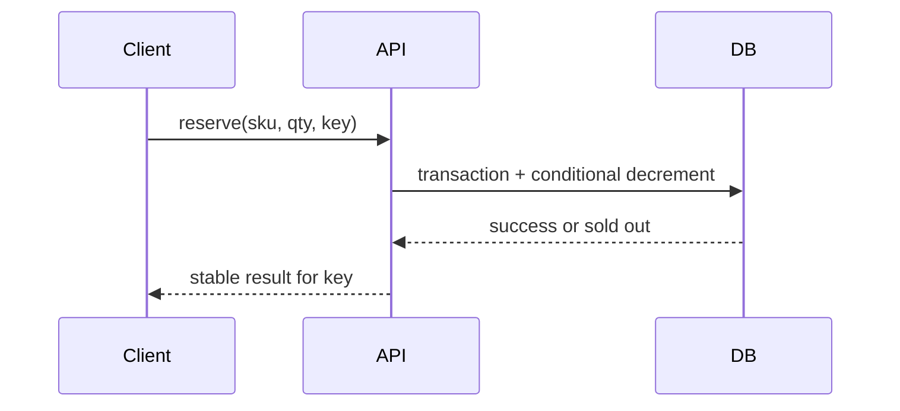
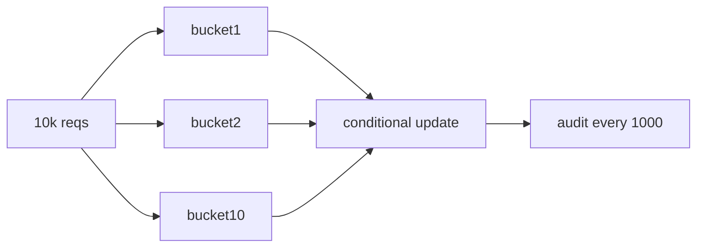

# Flash-sale inventory patterns

[Back](../../README.md)

## Why

A flash sale creates a hot key: many requests compete for a small stock count. Confirmed reservations must never exceed supply, even with retries, duplicate requests, timeouts, and worker crashes.

## How

Keep the decision at the source of truth:

```sql
UPDATE inventory
SET available = available - :qty
WHERE sku = :sku AND available >= :qty;
```

If one row updates, create a reservation in the same transaction. If zero rows update, return sold out. Attach an idempotency key so a retry returns the original reservation instead of decrementing twice.



## Under the hood

The conditional update is an atomic compare-and-check at the database boundary. A cache may absorb reads, but it cannot be the authority unless its durability and fencing semantics are designed for this invariant.

At extreme scale, shard inventory into buckets or pre-allocate tokens. This spreads a hot row, but reconciliation and token ownership become part of correctness.

Use a queue to smooth bursts only if reservation semantics are explicit. A queue protects the database from overload; it cannot create stock.

## Production use cases

Limited products, seat allocation, appointment slots, and scarce compute quotas.

## Trade-offs and failure modes

| Pattern | Benefit | Risk |
|---|---|---|
| Conditional DB update | strong invariant, simple source of truth | hot-row contention |
| Pessimistic row lock | clear serialization | queueing and lock timeout |
| Optimistic version | no blocking | retry storm on hot SKU |
| Token buckets | spread contention | token leakage and reconciliation |
| Queue admission | protects DB | delayed result and poison messages |

## Observability

Track successful and sold-out reservations, duplicate-key hits, conditional-update conflicts, queue age, lock wait, invariant checks, and reconciliation drift.

## Lab

Load one SKU with 1,000 requests for 100 units. Include 10% retries and 1% client timeouts. Verify exactly 100 successful reservations, stable duplicate-key results, and zero negative stock.

## Worked examples

**Situation: 10,000 requests, 1,000 units, 10% retries, 1 SKU.**
DB ceiling = 5,000 conditional updates/second on one row. 10,000 requests in a 2-second window = 5,000 rps → exactly at ceiling. p50 = 500 ms, p99 = 2,000 ms. With 10% retries (1,000 duplicates), the effective load is 11,000 → 20% over ceiling. 2,000 requests timeout. The timeout clients retry, adding 2,000 more → 13,000 total → 40% over. The system oscillates.

Fix: token buckets. Split 1,000 units into 10 buckets of 100. Each bucket handles 1,000 requests. Throughput per bucket = 5,000 rps / 10 = 500 rps/bucket. 1,000 requests per bucket drain in 2 s per bucket. Total drain = 10 × 2 s = 20 s, but requests are spread across buckets so the wall-clock is 2 s. Reconciliation: every 1,000 allocations, audit `sum(buckets) == total_sold`.



## How to use this topic

Use the sequence: [basics](basics.md) for the worked example, [information](information.md) for production reference, and [mechanism lesson](learn/01-mechanism.md) for a guided exercise. Every design decision should trace back to the invariant and a measured failure mode.
