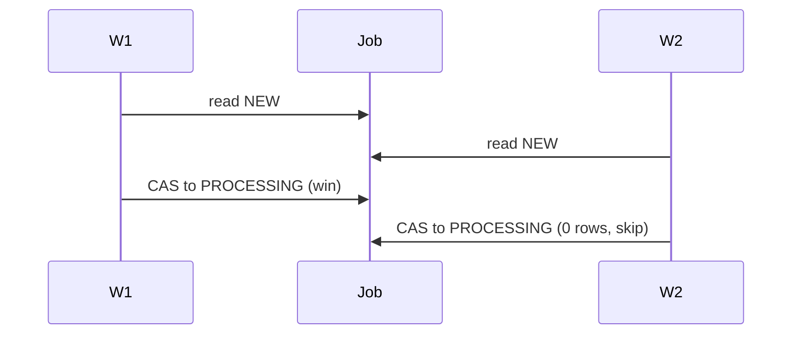

# Race conditions

[Back](../../README.md)

## Why

A race condition appears when two or more operations depend on an unstated execution order. The code looks correct in a single-threaded trace, but a different interleaving produces a bad state.

In production, races become incidents: duplicate charges, oversold stock, inconsistent cached counters, and failed failover.

## How

Identify the invariant, then list every read-modify-write sequence.

```text
Inventory invariant:  stock >= 0
Read stock
Read request quantity
Check stock >= quantity
Write stock - quantity
```

Two requests may both read the old stock value before either writes. The invariant holds in each thread locally but not globally.

A race is a **dependency on a non-atomic compound transition**, not the mere presence of multiple threads. The fix is to make the critical section atomic, explicit, or safe under all interleavings.

## Under the hood

Three common race shapes:

### Check-then-act

```text
if not exists(id):
    insert(id, value)
```

A competing writer may insert between the check and the write. Fix: unique key + insert-if-absent, or a lock.

### Read-modify-write

```text
counter = read(counter)
counter += 1
write(counter)
```

The write may overwrite another writer's increment. Fix: atomic CAS, row lock, or serialized queue.

### Lost delete

```text
if exists(id):
    delete(id)
```

The record may be replaced before the delete runs. Fix: conditional delete or delete by version.

Memory visibility is a fourth dimension: one core may not immediately observe another core's write. Correct code uses the language or runtime synchronization primitive that establishes **happens-before** relationships.

## Production use cases

- Distributed worker claims the same job twice.
- User cart updates two items; the last write wins.
- A rate limiter over-counts permits under concurrent requests.
- A cache entry is inserted while TTL logic is evaluating expiration.

## Trade-offs and failure modes

| Choice | Gains | Costs | Failure to watch |
|---|---|---|---|
| Detect after the fact | cheaper fast path | damage already done | detection window |
| Prevent with a lock | correct under all interleavings | contention and deadlocks | lock starvation |
| Prevent with CAS | lock-free fast path | ABA and retry storms | stale value overwritten |

## Observability

- Log every transition with the pre/post value and the actor.
- Periodically validate the invariant in production (invariant checkers).
- Alert on p99 of retry count and on duplicate job claims.

## Lab

Reproduce a lost update. Two workers, one counter, 10,000 increments each. Record the observed value. Then fix it with atomic increments and with a lock, and compare throughput.

## Worked examples

**Situation: two workers claim the same job.**
Job queue holds 10,000 jobs. Two workers poll at 100 rps each. Without a check-then-act guard, a 10 ms polling overlap means ~200 duplicates per second in the worst case (200 × 10/1000). With `UPDATE job SET state='processing' WHERE state='new'`, exactly 10,000 jobs get claimed once. The duplicate rate drops to 0; the cost is 1 extra index lookup per claim (~0.5 ms).



## How to use this topic

Use the sequence: [basics](basics.md) for the worked example, [information](information.md) for production reference, and [mechanism lesson](learn/01-mechanism.md) for a guided exercise. Every design decision should trace back to the invariant and a measured failure mode.
