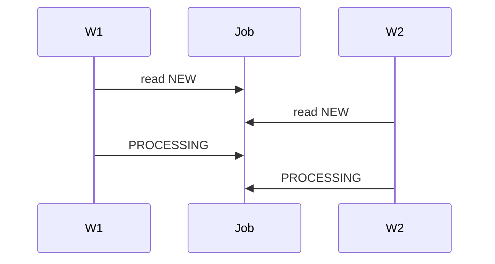

# Basics: race conditions

[Back](README.md)

## Why

Learn race conditions by first naming the invariant, workload, and failure that make the topic necessary.

## How

Start with one concrete request and trace it from input to durable state. Then identify where concurrency, latency, failure, or approximation changes the result.

## Under the hood

Separate the control path from the data path. Record the state machine, key data structures, complexity, and the boundary where correctness is enforced.

## Checkpoint

- What must never happen?
- Which component owns the truth?
- What does a timeout mean?
- What measurement would falsify the design?

## Worked example: two workers, one job

```text
t=0.000  W1 reads job state NEW
t=0.001  W2 reads job state NEW
t=0.002  W1 writes PROCESSING
t=0.003  W2 writes PROCESSING
t=0.010  both enqueue the same payment
```

The expected transition is one `PROCESSING` owner. The observed result can be two workers charging one customer. At 10 jobs/second, a 10 ms check-then-act window exposes a race about once every `10 / (10*0.01)` — the arithmetic is not the point; the point is that two overlapping reads are enough to break the invariant.



Fix with `UPDATE job SET state='PROCESSING', owner='W2' WHERE id=? AND state='NEW'` and require one row affected. The safe transition is atomic at the write boundary.

