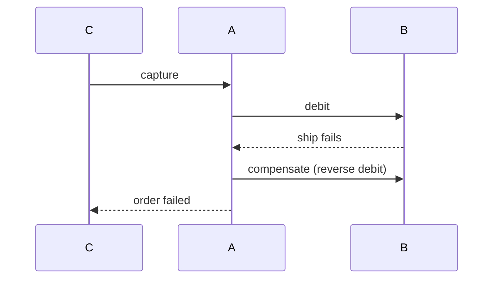

# Distributed transactions

[Back](../../README.md)

## Why

Sometimes state changes must span multiple stores or services. A distributed transaction coordinates the outcome so that the whole commit succeeds or the whole commit fails.

## How

Common patterns, ordered from weakest to strongest:

- **Two-phase commit (2PC)** — coordinator asks each participant to prepare, then tells it to commit or abort. Requires all participants to stay available between prepare and commit.
- **Sagas** — each step is a local transaction with a compensating action. If a later step fails, run the compensations in reverse. No global lock; eventual consistency.
- **Outbox + event sourcing** — write the event alongside the state change in one store. A publisher reads the outbox and delivers it. Other services react idempotently.
- **Transactional outbox** — the outbox row is in the same transaction as the state, avoiding the dual-write gap.
- **Exactly-once at the boundary** — usually not achievable; use idempotent consumers and replay.

## Under the hood

A 2PC coordinator's log must be durable: if it crashes after telling participants to commit, the coordinator must recover and complete. A participant that prepared but did not hear the commit is in an **in-doubt** state; it waits for the coordinator or for a recovery protocol.

A saga moves the compensation to application code. Each step exposes both an action and a compensation. The orchestrator or choreography keeps a state machine of completed steps so recovery can resume.

## Production use cases

- Money movement across ledgers: saga with compensating entries.
- Order-to-payment to-shipment: outbox and saga with timeouts.
- Multi-store configuration: outbox plus idempotent applier.

## Trade-offs and failure modes

| Pattern | Guarantee | Failure to watch |
|---|---|---|
| 2PC | atomic across participants | in-doubt lockout if coordinator dies |
| Saga | eventual consistency with compensation | compensation failure or partial success |
| Outbox + idempotent consumer | at-least-once delivery | outbox row accumulates when consumer fails |
| Effectively-once | retries dedupe | key collision or scope errors |

## Observability

Track saga step progress, in-doubt age, outbox lag, compensation count, and replay rate. Alert when in-doubt or outbox rows outlive a threshold.

## Lab

Implement a payment saga: capture → debit → ship. Force a failure at ship. Verify that compensation reverses the debit and that replaying the saga does not re-capture.

## Worked examples

**Situation: payment saga, 1,000 rps, step failure rate 0.1%.**
```text
steps: capture → debit → ship
failure at ship: 0.1% × 1,000 = 1 failure/second
compensation: debit reversed in 50 ms
```
At 1,000 rps, the outbox table grows by 3 rows per successful transaction. At 1,000 rps, that's 3,000 rows/second = 10.8M rows/hour. The publisher must drain 3,000/second. With a 100 ms batch poll and 50 ms delivery: drain = `3,000 × 0.1 / (0.1 + 0.05) = 2,000/second`. Lag = 1,000/second → 60,000 rows in 60 s. Increase batch to 500 rows: drain = `500 × 0.1 / (0.1 + 0.05) ≈ 3,333/second`. Lag eliminated.

2PC alternative: coordinator + 2 participants. In-doubt window = coordinator MTBF + recovery ≈ 30 days + 5 min. At 1,000 rps with 0.001% 2PC failures: expected in-doubt = `1,000 × 0.00001 × 300s ≈ 3` concurrent in-doubt rows. The saga's outbox approach has ~60K rows lag but no in-doubt locks. The 2PC approach has 3 in-doubt locks at any time but no outbox growth.



## How to use this topic

Use the sequence: [basics](basics.md) for the worked example, [information](information.md) for production reference, and [mechanism lesson](learn/01-mechanism.md) for a guided exercise. Every design decision should trace back to the invariant and a measured failure mode.
