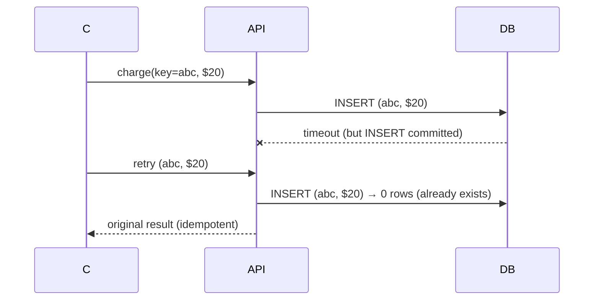

# Introduction to distributed systems

[Back](../../README.md)

## Why

Distribution buys capacity, isolation, geographic reach, and independent deployment. It also introduces network delay, dropped messages, duplicate delivery, reordering, process pauses, and partitions. A local function call either returns or throws; a network call may have completed even when the caller timed out.

## How

Treat every remote call as an uncertain protocol:

```text
caller ── request ──> service
caller <── response? ── service
```

A missing response is ambiguous. The service may be down, the response may be delayed, or the operation may have succeeded while the reply was lost. Use operation IDs, idempotent handlers, durable state, timeouts, and explicit retry policy.

## Under the hood

The key differences from a single process:

- **No shared memory:** state crosses a serialization and network boundary.
- **No exact global time:** clocks drift; timestamps need bounds and monotonic ordering rules.
- **Partial failure:** one component can fail while others continue.
- **Independent progress:** one process can pause indefinitely while others run.
- **Reordering:** packets and messages can arrive in a different order than sent.

A distributed design is a set of state machines plus protocols that move messages between them. Specify message semantics: at-most-once, at-least-once, or effectively-once through idempotency.

## Production use cases

Replicated storage, microservices, queues, geo-replicated APIs, search clusters, and media pipelines.

## Senior questions

- What state must be strongly consistent?
- What can be stale or duplicated safely?
- How does a caller distinguish a failure from an unknown outcome?
- What is the recovery source of truth?

## Lab

Build a two-service request with an injected delay, dropped response, duplicate request, and reordered event. Add an idempotency key and inspect which outcomes become safe.

## Worked examples

**Situation: 3-hop payment request, 1% transient network failures.**
```text
client → CDN (10 ms) → API (5 ms) → DB (3 ms)
p50 = 18 ms
p90 = 58 ms (10% of calls hit a 50 ms RTT spike)
p99 = 218 ms
```
Without idempotency: 1% of 10,000 rps = 100 duplicate business ops/second. With `X-Idempotency-Key`: 100 no-ops, 0 duplicates. The dedup store is a 1-minute TTL Redis holding `key → result`; at 100,000 keys/min, that's 100,000 × 64 bytes ≈ 6.4 MB — trivially cheap.



## How to use this topic

Use the sequence: [basics](basics.md) for the worked example, [information](information.md) for production reference, and [mechanism lesson](learn/01-mechanism.md) for a guided exercise. Every design decision should trace back to the invariant and a measured failure mode.
