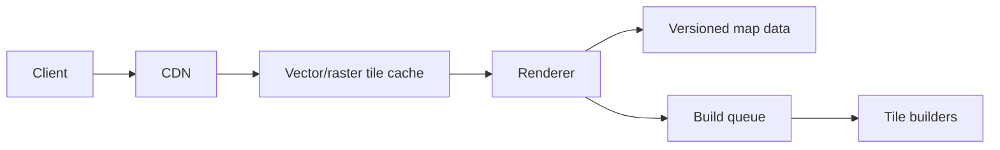

# Designing a map rendering service

[Back](../../README.md)

## Why

Maps combine large immutable-ish datasets, expensive geometry processing, high read fan-out, and bursty geographic demand. Rendering every map from raw data on every request is too slow and expensive.

## How



Precompute tiles by zoom, x, and y. Serve immutable versioned tiles through a CDN. Rebuild affected tiles when source data changes. Clients fetch only the visible tile set and may request adjacent tiles for smooth panning.

## Under the hood

A tile coordinate maps a viewport to a bounded set of cells. The renderer simplifies geometry at lower zoom levels, preserves topology, and encodes labels/features. Tile builds are content-addressed or versioned, so a client never sees a half-written tile.

Use a manifest to atomically switch from map version `v` to `v+1`. Keep old versions until cache expiry and rollback needs pass.

## Production use cases

Navigation maps, weather layers, fleet tracking, and offline map packages.

## Trade-offs

| Choice | Benefit | Cost |
|---|---|---|
| Raster tiles | simple client | large payload, less styling flexibility |
| Vector tiles | client styling, smaller at scale | client complexity |
| Precompute | low read latency | build/storage cost |
| Render on demand | fresh and flexible | CPU tail latency |

## Observability

Tile cache hit ratio, build lag, tile generation p99, CDN egress, stale-version rate, and error rate by zoom/region.

## Lab

Build tiles for a small dataset at zoom levels 0–8. Measure tile count, payload size, build time, and cache hit ratio under a pan/zoom trace.

## Worked examples

**Situation: 1080p viewport, zoom 8, vector tiles.**
```text
zoom 8 world = 256 × 256 = 65,536 tiles
viewport 6×4 = 24 tiles + 1 ring = 48 tiles
vector tile ≈ 10 KB
CDN hit rate = 90%
```
p50 bytes = 48 × 10 KB × 0.9 (CDN) + 48 × 10 KB × 0.1 × 3 (origin) = 432 + 144 = 576 KB.
Raster at 512×512 px ≈ 200 KB/tile: 48 × 200 KB = 9.6 MB. Vector wins by ~17×.

Zoom 12 = 1024×1024 = 1,048,576 tiles. A 6×4 viewport is still 24 tiles. The source dataset grows; build time at 50 ms/tile, single-threaded: 1M × 0.05 s = 52 hours. With 8 workers: 6.5 hours. The build SLA is the constraint, not the query.

```text
vector:  576 KB / viewport
raster:  9.6 MB / viewport
build:   52 h → 6.5 h (8 workers)
```

## How to use this topic

Use the sequence: [basics](basics.md) for the worked example, [information](information.md) for production reference, and [mechanism lesson](learn/01-mechanism.md) for a guided exercise. Every design decision should trace back to the invariant and a measured failure mode.
