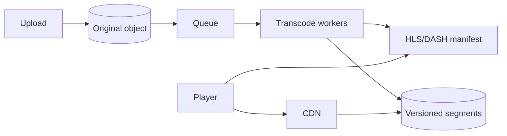

# Video transcoding and playback

[Back](../../README.md)

## Why

Devices and networks differ in codec support, resolution, bitrate, and bandwidth. One uploaded video cannot serve every client efficiently. Transcoding creates a ladder of playable representations; playback adapts to current conditions.

## How



The player requests a manifest, chooses a rendition, and downloads short segments. It measures buffer health and observed throughput, then switches rendition at segment boundaries.

## Under the hood

A transcoding job is a durable state machine:

```text
QUEUED → RUNNING → SUCCEEDED
              └──→ RETRYABLE_FAILURE → QUEUED
              └──→ PERMANENT_FAILURE
```

Workers checkpoint by segment or timestamp. A job key makes retries idempotent. Store outputs under a content/version key; publish the manifest only after all referenced segments exist.

Adaptive bitrate ladders balance quality against storage and encoding cost. More renditions improve adaptation but multiply CPU, storage, and CDN cache keys.

Playback latency depends on segment duration, manifest polling, CDN cache hit, and buffer target. Short segments reduce startup and switching delay but increase request overhead.

## Production use cases

Video-on-demand, live streaming, user-generated content, and offline downloads.

## Trade-offs and failure modes

| Choice | Benefit | Cost |
|---|---|---|
| Longer segments | fewer requests, better compression | slower switching and startup |
| Shorter segments | lower latency | more request and manifest overhead |
| More renditions | smoother adaptation | more encode/storage/CDN cost |
| Pre-transcode | predictable playback | slow publish time |
| Just-in-time encode | lower unused work | startup latency and capacity spikes |

## Observability

Startup time, rebuffer ratio, rendition switches, CDN hit rate, encode backlog age, worker failure rate, segment availability, and manifest-to-segment errors.

## Lab

Transcode one source into a three-rendition ladder. Simulate changing bandwidth. Measure startup, rebuffering, switch time, storage, and encoding CPU.

## Worked examples

**Situation: 30 min source, 4-rendition ladder, 1,000 videos/day.**
```text
source:  30 min × 5 Mbps ≈ 1.1 GB
ladder: 0.5 + 1 + 2.5 + 5 = 9 Mbps → 2.0 GB (80% overhead)
```
Storage per video = 2.0 GB. 1,000 videos/day → 2 TB/day. At $0.023/GB-month (S3 standard): 2,000 GB × 30 × $0.023 = $1,380/month.

Encode time: 8-core worker, 1× real-time per rendition. 30 min × 4 = 120 min of encode time per video. 1,000 videos × 120 min = 20,000 min = 333 hours of CPU. 10 workers at 1× real-time: 333 hours / 10 = 33.3 hours. SLA = 24 hours → need ~14 workers.

Adaptive playback: 4 s segments, 30 s buffer. Bandwidth drops from 3 Mbps to 1 Mbps. Player switches at segment boundary (~2 s). Rebuffer risk = buffer / segment duration = 30/4 = 7.5 segments of headroom. At 1 Mbps on a 2.5 Mbps rendition, drain rate = 2.5/1.0 = 2.5× faster than fill → buffer depletes in 30/1.5 = 20 s. The switch to 1 Mbps saves the stream.

```text
storage: 2 TB/day → $1,380/month
CPU: 333 h → 14 workers for 24 h SLA
rebuffer: 20 s headroom at 1 Mbps
```

## How to use this topic

Use the sequence: [basics](basics.md) for the worked example, [information](information.md) for production reference, and [mechanism lesson](learn/01-mechanism.md) for a guided exercise. Every design decision should trace back to the invariant and a measured failure mode.
