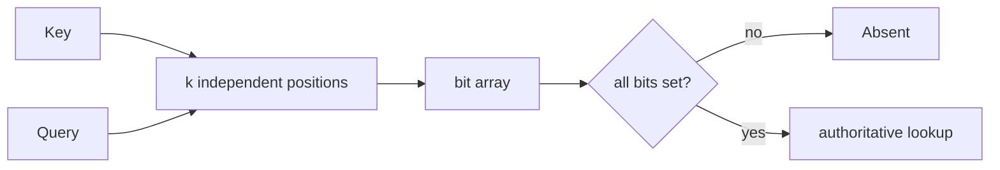

# Bloom filters

[Back](../../README.md)

## Why

Before querying a slow database or object store, ask whether a key could exist. A Bloom filter can reject definitely-absent keys using a small bit array.

## How

```text
insert(key): set k hash-derived bits
query(key): if any bit is 0 → definitely absent; else → maybe present
```



## Under the hood

For `m` bits, `n` inserted keys, and `k` hashes, the false-positive probability is approximately:

```text
p ≈ (1 - e^(-kn/m))^k
```

The optimal number of hashes is approximately `k = (m/n) ln 2`. More bits per key lower false positives. Deletion is not safe with a plain bit array: clearing a bit can remove another key's membership. Use a counting Bloom filter or rebuild for deletion.

A Bloom filter never proves presence. Every positive must go to the source of truth.

## Production use cases

Cache penetration protection, SSTable/key lookup avoidance, duplicate-event hinting, and URL/domain filters.

## Failure modes

- Filter fills beyond design `n`: false-positive rate rises.
- Hash version mismatch: valid keys appear absent.
- False positives become correctness bugs when used to reject a key.

## Lab

Size filters for 1 million keys at 1%, 0.1%, and 0.01% target false-positive rate. Measure actual rate with unseen keys and track memory per key.

## Worked examples

**Situation: 1M URLs, 1% false positive target.**
```text
n = 1,000,000, p = 0.01
m = -n·ln(0.01) / (ln 2)² ≈ 9.6M bits ≈ 1.2 MB
k = (m/n)·ln 2 ≈ 6.6 → use 7
```
Exact set: 1M × 32 bytes = 32 MB. Bloom: 1.2 MB → 27× smaller.

Over-insertion: 2M keys into a 1M-sized filter → fill fraction rises → FP rate jumps from 1% to ~23%. Track `inserts` count. At 80% of design n, rebuild at the new size.

Counting Bloom filter (4-bit counters): 4 × 1.2 MB = 4.8 MB. Supports delete but overflows at count > 15. For a TTL-based cache where deletes are rare, a plain Bloom + periodic rebuild is cheaper than a counting filter.

```text
plain:   1.2 MB, 1% FP, no delete
counting: 4.8 MB, 1% FP, delete, 15-count overflow
```

## How to use this topic

Use the sequence: [basics](basics.md) for the worked example, [information](information.md) for production reference, and [mechanism lesson](learn/01-mechanism.md) for a guided exercise. Every design decision should trace back to the invariant and a measured failure mode.
