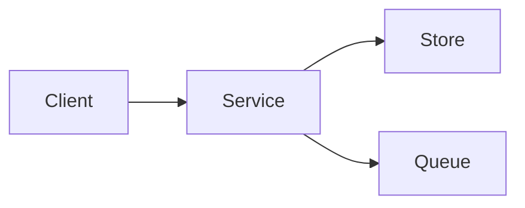

# Topic template

Every topic should answer the same questions. Copy this outline when adding a lesson.

## Why

What production problem appears without this technique? Define the workload, correctness invariant, and user-visible consequence.

## How

Show request, data, and control flow. Prefer a diagram:

## Under the hood

Explain state, data structures, algorithms, memory layout, CPU/network work, persistence, and failure semantics. Include complexity and assumptions.

## Production use cases

Name workloads where this design fits. Include scale, latency, availability, consistency, cost, and security constraints.

## Trade-offs and failure modes

| Choice | Gains | Costs | Failure to watch |
|---|---|---|---|
| Option A | | | |

## Observability

List metrics, logs, traces, alerts, and useful dashboards. Explain what each signal means.

## Lab

Give prerequisites, steps, expected observations, and questions that force measurement.

## Senior review questions

- What invariant must never break?
- Where is the source of truth?
- What happens during retry, timeout, duplication, reordering, and partition?
- How does capacity change at the saturation knee?
- What recovery action is safe after partial failure?
