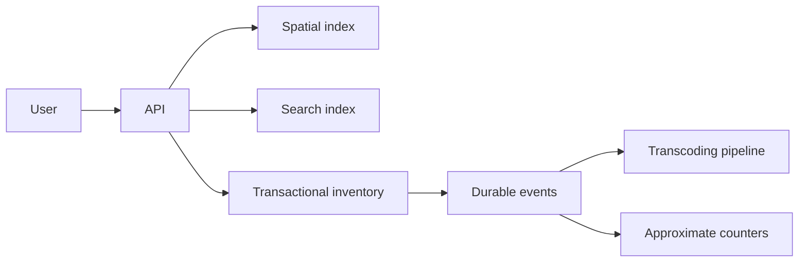

# Capstone: Local commerce platform

Design a platform where customers search nearby inventory, reserve stock, upload product media, and receive results during a flash sale.

## Required flows

## Constraints

Define a realistic workload, but include burst traffic, hot products, duplicate requests, stale search documents, worker crashes, and a region partition. Preserve the invariant that confirmed reservations never exceed available stock.

## Deliverables

1. API contract and state machine.
2. Component diagram and data ownership map.
3. Capacity estimate and latency budget.
4. Choice of transaction/isolation and locking strategy.
5. Search indexing and geospatial candidate-selection plan.
6. Chunked upload and adaptive playback design.
7. Failure matrix, retry/idempotency policy, and recovery runbook.
8. Metrics, alerts, load test, and fault-injection plan.
9. Trade-off record naming rejected alternatives.

Review the result with the [design checklist](../design-review-checklist.md).
