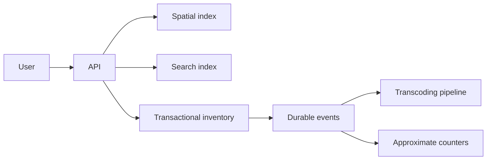

# Capstone: Local commerce platform

Design a platform where customers search nearby inventory, reserve stock, upload product media, and receive results during a flash sale.

## Required flows



## Constraints

Define a realistic workload, but include burst traffic, hot products, duplicate requests, stale search documents, worker crashes, and a region partition. Preserve the invariant that confirmed reservations never exceed available stock.

## Deliverables

1. API contract and state machine.
2. Component diagram and data ownership map.
3. Capacity estimate and latency budget.
4. Choice of transaction/isolation and locking strategy.
5. Search indexing and geospatial candidate-selection plan.
6. Chunked upload and adaptive playback design.
7. Failure matrix, retry/idempotency policy, and recovery runbook.
8. Metrics, alerts, load test, and fault-injection plan.
9. Trade-off record naming rejected alternatives.

Review the result with the [design checklist](../design-review-checklist.md).

## Worked numbers

**Baseline workload (fill these in before designing):**

| Parameter | Value |
|---|---|
| Daily active users | 1,000,000 |
| Peak rps (flash sale) | 50,000 |
| Search index size | 10M documents |
| Spatial index | 1M POIs |
| Media uploads/day | 100,000 videos × 2 GB = 200 TB |
| Reservations/day | 500,000 |
| SLO p95 latency | 100 ms |
| SLO availability | 99.95% (4.4 h/year downtime) |

**Latency budget: p95 = 100 ms, 4 sequential hops.**
```text
CDN:        10 ms
API:         5 ms compute
Spatial:    20 ms (S2 level 15, ~3,100 candidates)
DB:          5 ms
sum p50 = 40 ms → 60 ms headroom
```
Tail: p99 of spatial = 80 ms (cold cache). 4 hops × 2× p50 = 80 ms p99 of sum. The spatial cache is the bottleneck.

**Inventory: 50,000 rps on 1 SKU, 1,000 units.**
```text
DB ceiling: 5,000 conditional updates/s
10 buckets × 100 units: 500 rps/bucket
50,000 rps / 10 buckets = 5,000 rps/bucket → 10× over
20 buckets: 2,500 rps/bucket → still 5× over
Fix: admission queue, 5,000 rps total, rest get "sold out" after 2 s
```

**Search: 10M docs, 5,000 qps.**
```text
BM25 top 100: 20 ms
Feature fetch ×100 (parallel, 10 fetchers): 10 ms
Blend + sort: 5 ms
p95 = 35 ms ✓ inside 100 ms budget
```

**Media: 100,000 videos/day, 4-rendition ladder.**
```text
Storage: 100,000 × 2 GB = 200 TB/day
Cost: 200,000 GB × 30 × $0.023 = $138,000/month
Encode: 100,000 × 120 min × 4 = 500,000 h CPU
100 workers at 1× real-time: 500,000/100 = 5,000 h = 208 days
Need 30-day SLA → 3,333 workers
```

**Analytics: 500M events/day, HLL m=4096.**
```text
4,096 registers × 6 bits = 3 KB
error = 1.04/√4,096 = 1.6%
on 500M uniques: ±8M (far too large for billing)
m=1,048,576 (2^20): 768 KB, error = 1.04/1024 = 0.1% → ±500K
```

**Region partition: 3 regions, W=2, R=2.**
```text
1 region down: 2 of 3 → quorum → can commit
2 regions down: 1 of 3 → no quorum → writes blocked
During 30 min partition of 1 region:
  that region's writes (33% of 50,000 rps = 16,667 rps) queue
  30 min × 16,667 = 3,000,000 queued requests
  On heal: drain at 50,000 rps → 60 s to clear
```
