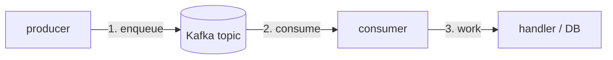

# 04 — Asynchronous latency: the queue changes the question

The base stack is *synchronous*: one request, one response, one p99. The message queue *breaks* that assumption. The producer *enqueues* and returns; the consumer *processes* later, on a *different* timeline. There is no single request p99 that covers the *whole* flow. The senior engineer now measures *two* latencies and a *depth*.

## The topology



Two distinct latencies, one queue in between:

| Quantity | What it is | The *wrong* thing to do with it |
|---|---|---|
| **Producer latency** | time from `produce()` to *ack* (the broker accepted the message). | Treating it as "the request finished." It did *not*; the work is *queued*. |
| **Consumer latency** | time from *consume* to *process-done*. A *different* p99, on a *different* timeline. | Comparing it to the producer latency and calling the gap "the queue time." |
| **Queue depth** | number of *unconsumed* messages (consumer lag). | Ignoring it. It is the *leading indicator* of everything. |

## The three numbers you must watch

### 1. The consumer lag (the leading indicator)

```
kafka_consumergroup_lag{group="shop", topic="orders"}
```

Lag = the number of messages *behind* the consumer. Lag = 0 means the consumer is keeping up. Lag *climbing* means the consumer is *slower than the producer*. **A climbing lag is the single most important number in an async system.** It is the *queue*, and the queue is where the latency *lives*.

The *alert* is on the lag, not on the consumer p99:

```
kafka_consumergroup_lag > 1000 for 5m   # consumer is behind
```

### 2. The producer ack latency

The time for `produce()` to return an *ack* (the broker confirmed the message). This is *fast* (a broker write, ~a few ms). It does *not* include the consumer's work. **A fast producer ack is *not* "the request is done."** The work is *queued*. The senior engineer's habit: *never* report a producer ack as the end-to-end latency. The end-to-end latency is *producer ack + queue wait + consumer time*, and the queue wait is the *lag-driven* part.

### 3. The consumer processing p99

The *consumer's* own histogram: `histogram_quantile(0.99, ...)` of the consumer's processing time. This is the *work* time, *not* the *queue* time. A consumer p99 of 50 ms with a *climbing lag* means the *queue* is growing *faster* than the 50 ms consumer can drain it. The *queue wait* is *unbounded* while the lag climbs.

## The *queue wait* is the invisible number

The *end-to-end* latency of a message is:

```
e2e = producer_ack + queue_wait + consumer_time
```

`queue_wait` is *not directly measured* — it is the time a message *sat in the queue* between produce and consume. You *infer* it from the lag:

- **Lag ~ 0** (consumer keeping up): `queue_wait ≈ 0`. e2e ≈ producer_ack + consumer_time. The async path *looks* synchronous.
- **Lag climbing** (consumer falling behind): `queue_wait` is *growing*. A message produced *now* will wait *longer* than one produced 5 minutes ago (it is behind more messages). The e2e is *unbounded* while the lag climbs.

The *signal* that the queue wait has become a problem: **the lag is non-zero and *climbing*.** Not the lag's *value* (a steady high lag is *bad but stable*), but the *derivative* (a *climbing* lag is *worsening*). The alert:

```
# A *rising* lag, not a high lag
kafka_consumergroup_lag{group="shop"} and
(delta(kafka_consumergroup_lag{group="shop"}[5m]) > 0)
```

In practice: alert on the lag *rate* (`rate(kafka_consumergroup_lag[5m]) > 0`), or on the lag crossing a threshold *and* the producer rate exceeding the consumer rate.

## The Little's-law tie-in

The consumer is a *queue with a service time*. Little's law applies to the *consumer*:

```
L_consumer = λ_producer × W_consumer
```

where `L_consumer` is the *lag* (messages in the queue), `λ_producer` is the *produce* rate (messages/s), and `W_consumer` is the *mean* consumer time (s/message).

Rearranged: **the steady-state lag is `λ_producer × W_consumer`.** If the producer is 1000 msg/s and the consumer takes 2 ms/message, the lag is `1000 × 0.002 = 2` messages. Tiny. If the consumer takes 5 ms/message, the lag is `1000 × 0.005 = 5` messages *in steady state* — *but only if the consumer can keep up*. The *condition* for keeping up is `W_consumer < 1/λ_producer` (the service time must be less than the *inter-arrival* time).

**The capacity of the consumer is `1 / W_consumer` messages/s.** If `λ_producer > 1/W_consumer`, the lag *grows without bound*. That is the *knee* of the async system: the producer rate at which the consumer can no longer keep up. It is the same shape as `capacity/02`, with `λ` replaced by the *produce* rate and `W` by the *consumer* time.

## The *fan-in* danger

Multiple *producers* into one topic, one *consumer group*. The consumer group's *total* throughput is bounded by the *sum* of its consumers' throughputs. If *one* consumer is slow (a *straggler*), the *partition* it owns backs up, and the *whole group's* lag rises. The senior engineer's habit: **check the *per-partition* lag, not just the *group* lag.** A *one partition* backing up is a *straggler*; *all* partitions backing up is a *throughput* problem.

```
# Per-partition lag
kafka_consumergroup_lag{group="shop", partition="3"}  # high
kafka_consumergroup_lag{group="shop", partition="4"}  # 0
```

Partition 3 is *behind*. The consumer on partition 3 is the straggler. The *group* lag is a *smear* of the per-partition lags; the *per-partition* view is the *real* one.

## Where the queue shows up in the other topics

- **Latency percentiles**: the *end-to-end* p99 is *not* a single histogram. It is a *distribution over messages*, and the *tail* is the *lag-driven* wait. The *consumer* p99 is the *work*; the *lag* is the *wait*. You cannot compute the e2e p99 from the consumer histogram alone — you need the *produce time* and the *consume time* per message, *joined* (a *trace* that crosses the queue, see `observability/03`).
- **Little's law** (`capacity/01`): the consumer is the `L_max` knob (the consumer's concurrency). The producer is `λ`. The knee is where `λ_producer > 1/W_consumer`.
- **The queue** (`capacity/03`): the Kafka topic *is* the queue. Its *depth* is the lag. The *consumer* is the *service* that drains it. The *produce rate* is the *arrival rate*. This is `capacity/03` *verbatim*, with the names changed.

## The rule

An async system has *three* numbers, not one:

1. **The consumer lag** (the *queue depth*, the *leading indicator*).
2. **The producer ack** (the *enqueue* time, *not* the completion).
3. **The consumer p99** (the *work* time, *not* the *wait*).

The *end-to-end* latency is `ack + wait + work`, and the *wait* is the *lag-driven*, *invisible* number. **Watch the lag. It is where the latency lives.**

## The lab

`capacity/labs/async-lag.md` — drive the produce rate up, watch the lag climb, find the *knee* where the consumer can no longer keep up. The *per-partition* view finds the *straggler*.
