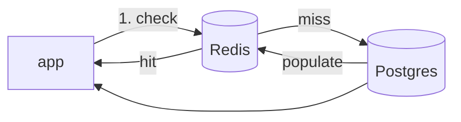

# 05 — The cache: two latency shapes in one system

A cache in front of the database is not a "faster database." It is a *branch* in the data path. The request either *hits* the cache (fast, no DB) or *misses* (slow, goes to the DB). The system's latency is now a *mixture* of two very different numbers.

## The topology



The *critical path* depends on the outcome:

- **Hit**: app → Redis → back. The DB is *not* on the path.
- **Miss**: app → Redis (miss) → Postgres → back. The DB *is* on the path.

The end-to-end p99 is *not* one number. It is the p99 of a *mixture*, weighted by the hit ratio.

## The metric that matters: the hit ratio

```
# Redis exporter
redis_keyspace_hits / (redis_keyspace_hits + redis_keyspace_misses)
```

The hit ratio is the *single* number that tells you which latency shape dominates:

- **High hit ratio** (0.95+): most requests are the *fast* shape. The DB p99 is *irrelevant* to the app p99, because the DB is rarely on the path. The app p99 ≈ the *hit* latency.
- **Low hit ratio** (0.5): half the requests are the *slow* shape. The app p99 is a *mixture*, and the *slow* shape is the one that *drives* the tail. The app p99 ≈ close to the *miss* latency.

**The senior-engineer read: the cache's hit ratio is a leading indicator of the app's tail.** When the hit ratio drops, the app's p99 *rises*, even if the DB is perfectly healthy. The DB is *fine*; the *cache* is the problem.

## The two shapes, concretely

| Shape | Latency | When it dominates |
|---|---|---|
| Hit | app → Redis RTT (~0.5–2 ms in-cluster) + handler | hit ratio high, key is warm |
| Miss | app → Redis miss + Postgres query + populate + back | hit ratio low, key is cold or evicted |

The *miss* shape is *asymmetric*: it is not "a little slower than a hit." It is "a *DB query* slower." The gap between a hit and a miss is the *entire DB latency*. That is why a cache failure does not degrade gracefully — it *steps* the app's latency up by the DB-query amount, all at once.

## The failure mode: the cache goes down

If Redis is *down* (not just a low hit ratio, but *unreachable*), the app must have a *fallback*:

- **Fallback to DB**: every request is the *miss* shape. The DB takes *all* the load that the cache was absorbing. The DB's pool saturates (see `database-latency/02`), and the *whole* system's p99 climbs a cliff.
- **Fallback to stale/none**: return a cached value or an error. The latency is the *fast* shape, but the *correctness* is degraded.

The *first* case is the dangerous one. A cache outage is a *DB* incident, in disguise. The senior engineer's habit: **when Redis errors spike, the *next* panel you look at is the DB pool, not the cache.** The cache is the *trigger*; the DB is the *victim*.

## Eviction and the cold-cache cliff

Redis evicts on `maxmemory` (the `allkeys-lru` policy is typical). A *cache stampede* — a hot key expires, N requests miss at once, N requests all hit the DB — is a *load amplifier* on the DB. The *first* request to re-populate wins; the other N-1 should *wait* for it, not *all* query the DB. The pattern is **cache-aside with single-flight** (or a *lock* per key during populate). Without it, a key expiry is a *DB spike*, not a miss.

The signal: `redis_keyspace_misses` *spikes* (not just a steady low hit ratio), and the DB pool pins *at the same moment*. The spike-then-pin pattern is the stampede.

## Where the cache shows up in the other topics

- **Latency percentiles** (`latency-percentiles/01`): the *tail-shape* is now *bimodal* (fast hits, slow misses). A histogram with fine buckets in the *hit* range and coarse buckets in the *miss* range is the right shape. A single uniform histogram *smears* the two modes.
- **Little's law** (`capacity/01`): the cache adds a *second* `L_max` knob (its max memory, its connection pool). The system's capacity is now the *minimum* of the cache's and the DB's.
- **Cardinality** (`observability/02`): the temptation to label by *key* is a cardinality bomb (a key is a per-item value, unbounded). The hit/miss *counters* are fine (two values: hit, miss). The *per-key* labels are not.

## The rule

A cache *branches* the data path. The latency of the system is a *mixture*, weighted by the hit ratio. The senior engineer watches:

1. **The hit ratio** (the *shape* indicator).
2. **The DB pool** (the *victim* when the cache fails).
3. **The miss *spike*, not the miss *level*** (the *stampede* detector).

## The lab

`database-latency/labs/cache.md` — drive the hit ratio down, watch the app p99 step up; then kill Redis, watch the DB pool pin. The *step* (not the slope) is the cache's signature.
