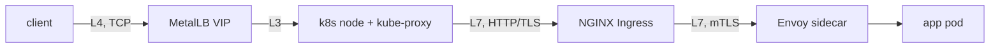

# 00 — L4 vs L7, and why the line between them matters

A load balancer can sit at different layers of the OSI model. The layer determines what it can *see* and therefore what it can *do*.

| Layer | Sees | Can do | Examples in this project |
|---|---|---|---|
| L3 | IP | Route by IP | k8s nodes |
| **L4** | TCP/UDP port, IP | Round-robin, health check by port | **MetalLB VIP**, cloud LBs |
| **L7** | HTTP method, path, headers, TLS | Route by path, header-based, TLS terminate, rate-limit, request-size limits | **NGINX Ingress**, Envoy, HAProxy in HTTP mode |

*(The user's initial ask said "L5." There is no L5 in the OSI model — L4 is transport, L7 is application. Treat the ask as L7.)*

## Where the L4/L7 boundary shows up in this project

The base path is three-deep. The extended stack (`project/01b-data-path`) adds a *third* L7 layer *inside* each pod (the Envoy sidecar), so routing is *four-deep* by the time a request reaches the app:

| Hop | Layer | What it sees |
|---|---|---|
| VIP | L4 (TCP) | IP, port. No app awareness. |
| NGINX | L7 (HTTP) | method, path, headers, TLS. |
| Envoy | L7 (mTLS, per-pod) | the same, *plus* version, retry, circuit-break. |

The client sees one VIP. The VIP is L4. NGINX and Envoy are *both* L7. Everything from NGINX down is *L7*. The app's own `http_request_duration_seconds` is *intra-app* (before the response goes back through Envoy and NGINX).

The *rule* that follows: when a metric says "latency is high," ask *which layer measured it*. There are now *three* L7 views (NGINX, Envoy, the app's own handler), and the *delta* between any two of them is a *specific* component. Do not average them.

1. **L4 has no app awareness.** If a pod is down at L7 (health check fails), L4 keeps sending to it until the L4 health check notices. That gap is the `load-balancing/03` lab.
2. **L7 adds latency.** TLS, proxy, log write, histogram observation. The L7 view is *always* slightly worse than the app view. The delta is meaningful.
3. **Session affinity is an L7 concept.** L4 is per-connection; L7 can stick by cookie. See `04`.
4. **Connection drain is an L4 + L7 joint problem.** The L7 layer must stop sending *new* requests to a draining pod, and the L4 layer must let *existing* connections finish. See `03`.

## The rule

When a metric says "latency is high," ask *which layer measured it*:

- `http_request_duration_seconds` (app) — intra-app.
- `nginx_ingress_controller_request_duration_seconds` (L7) — includes proxy + upstream + TLS.
- VIP-level metrics (L4) — includes all of the above plus the L4 path.

A delta between two of those is a *specific* component. Do not average them.
