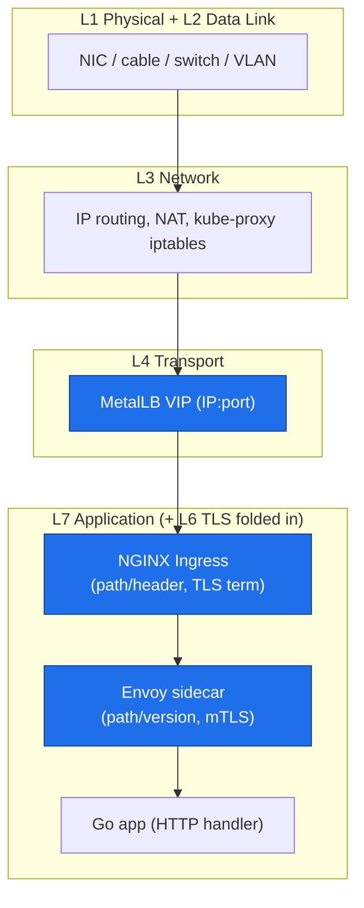

# 06 — The seven layers, one per line, and why only L4 and L7 have load balancers

## The confusion, named

The pasted text only ever says "L4" and "L7." It skips 5 and 6. That is not an error in the text — it is the *actual state of the world*. **Load balancers exist only at L4 and L7.** L5 and L6 are *model* layers (a bookkeeping convention for "session management" and "data formatting"). They have no hardware, no switch, no "L5 load balancer" you can buy. This doc is the full stack so the skip is *deliberate* and you stop expecting an L5 box.

## The seven layers, bottom to top, one line each

| # | Layer | Unit of data | What it actually is | Concrete thing in the stack |
|---|---|---|---|---|
| 7 | **Application** | bytes (a message) | The protocol an app speaks | HTTP request, DNS query, SMTP. **L7 LB = NGINX Ingress.** |
| 6 | **Presentation** | encoded data | *Format + encrypt* the data | TLS handshake, JSON↔binary, gzip. **TLS termination happens here, but people call it L7.** |
| 5 | **Session** | a session | *Establish / maintain / tear down* a session between apps | RPC, a session ID, checkpointing. **No LB here.** |
| 4 | **Transport** | a segment | *Port-to-port* delivery, reliability | TCP (reliable, ordered), UDP (fast, unreliable). **L4 LB = MetalLB VIP.** |
| 3 | **Network** | a packet | *Host-to-host* routing | The IP header, a router, a NAT. |
| 2 | **Data Link** | a frame | *Node-to-node* on one link | Ethernet frame, MAC address, a switch, a VLAN tag. |
| 1 | **Physical** | a bit | Volts, light on fiber | The NIC, the cable, a PHY. |

Read it *upward*: bits → frames → packets → segments → a formatted, encrypted, session-scoped message. Read it *downward*: the same thing, encapsulated at each layer.

## Why L4 is the *only* "below the app" LB

An L4 LB sees, per the table: **a TCP/UDP segment, with IP and port.** That is *all* it can see. It cannot read the HTTP method, the path, or the body, because those bytes are *payload* — *above* L4. So an L4 LB can only route by **IP:port**. That is the whole job: "all TCP on port 443 → backend A, all TCP on port 5432 → backend B." No app awareness. That is exactly MetalLB / a cloud LB / LVS.

## Why L7 is the *only* "in the app" LB

An L7 LB sees the **decoded message**: the HTTP method, the `Host`, the `Path`, the headers. That is *because* it sits *at or above* L7. It can route by `path=/api/products`, by `host=`, by a header, and it can *terminate* TLS (decrypt at the edge, send plain HTTP to the backend). That is NGINX Ingress / Envoy / a service mesh. The *price* of L7 visibility is L7 work: TLS, parsing, a log write, a histogram. The L7 view is *always* a few ms slower than the app's own view. See `02-l7`.

## The L5 / L6 "missing" layers, demystified

- **L5 (Session):** "Are we still talking? Are we on request #43 of this session?" In the real world this is *absorbed* into L7 protocols (an HTTP cookie is a session handle; a WebSocket is a session). You will never see an "L5 load balancer," because the *session* is tracked at the *application* layer.
- **L6 (Presentation):** "Encrypt this, then send it; on the other end, decrypt, then re-encode." TLS is *textbook* L6. But in practice TLS termination is done by an *application* device (NGINX, Envoy) at the *edge*, so the industry calls it **L7**. That is why you have not heard "L6 load balancer" — the box that does it is marketed as an L7 (TLS) LB.

**The one-line rule:** *The OSI model is a *teaching* stack of 7. The *real* network has 5 (L1–L4 hardware + L7 application; L5/L6 are folded into L7). Load balancers exist only at the two layers that carry a *routable* unit: L4 (a port) and L7 (a path).*

## Where each layer lives in *this* project

- **L4 LB** = `VIP`. Routes by IP:port. No app awareness.
- **L7 LB** = `NGX` *and* `ENV`. Route by path/header; terminate (m)TLS. *Two* L7 layers in the extended stack — the *delta* between them is the mesh's own cost (`load-balancing/05`).
- **L5/L6** = *no box*. The session is an HTTP cookie / a `shop-route` affinity cookie (`04`); the TLS is terminated at the L7 edge (which is why "L7" and "TLS" are used interchangeably in ops talk).

## The senior-engineer check

When a metric says "latency is high," the first question is *which layer measured it*. Now that L5/L6 are folded into L7, there are *three* "app-layer" views, and the *delta* between any two is a *specific* component:

| View | Includes | Does *not* include |
|---|---|---|
| App `http_request_duration_seconds` | handler + DB | TLS, proxy, L4, network RTT |
| NGINX `..._request_duration_seconds` | + TLS + proxy + upstream | L4 VIP path, client network RTT |
| Envoy `envoy_cluster_upstream_rq_time` | + mTLS + sidecar hop | NGINX, L4, client |
| Client `curl time_total` | *all of the above* | nothing |

Each row adds a layer. The *gap* between rows is the *cost* of that layer. A gap you cannot name is a gap you cannot debug. That naming exercise is the whole point of this doc: **you should be able to point at any one of the four numbers and say *which layers are inside it and which are outside*.**
