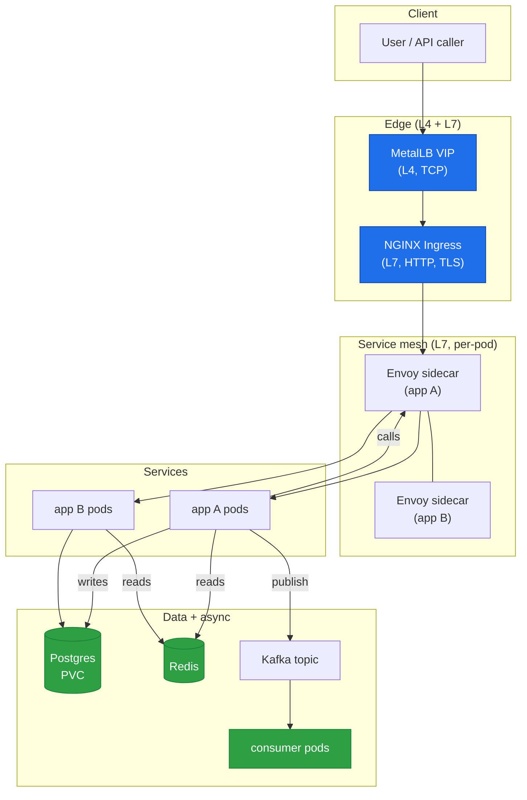

# 01b — The data path, end to end (with the extended stack)

The base stack (MetalLB → NGINX → app → Postgres) is the *minimum* observable system. The extended stack adds three subsystems that change what you watch and *where* the latency goes:

- **Envoy sidecar** (service mesh) — inter-pod traffic goes *through* Envoy, not direct pod-to-pod. Adds a measurable hop between the app and its dependencies.
- **Redis cache** — a fast path in front of Postgres. When the cache is hot, the DB is *not* on the critical path; when it misses, the DB *is*. Two very different latency shapes.
- **Kafka queue** — a *decoupling* point. The producer hands work to the queue and returns; the consumer picks it up later. The end-to-end latency is now *asynchronous* and no longer shows up in the request p99.

## The three new latency shapes

The base stack has one latency shape: *synchronous, one path*. The extended stack has three:

| Shape | Where | What the p99 measures |
|---|---|---|
| **Synchronous** | Client → VIP → NGINX → Envoy → app A → (Redis or PG) → back | The whole request, end to end. The p99 is one number. |
| **Fan-out** | app A → envoy → app B (two hops) | The *longest* hop dominates. The p99 is the max of the two, not the sum. |
| **Asynchronous** | app A → Kafka → consumer | The *producer* returns fast (enqueue is the request). The *consumer's* processing is a *different* latency, on a *different* timeline. No single p99 covers it. |

The asynchronous shape is the one that breaks the naive "p99 tells me the latency" assumption. The queue's *depth* and the *consumer's* p99 are two different numbers, and the senior engineer must watch both. See `capacity/03` (queues) and the new `capacity/04` (async latency).

## Where each new piece lives in the docs

| New piece | Doc |
|---|---|
| Envoy sidecar + mesh metrics | `load-balancing/05-service-mesh.md` |
| Redis cache hit/miss + the two latency shapes | `database-latency/05-cache.md` |
| Kafka producer/consumer latency + queue depth | `capacity/04-async.md` |
| All of the above, measured | `project/labs/extended-stack.md` |

## What does *not* change

The *principles* are unchanged. Little's law still applies — but `L_max` now has *more* knobs (the mesh's connection pool, the cache's max memory, the consumer's concurrency). The RED/USE frameworks still apply — but there is *more* to check (the mesh's saturation, the cache's hit ratio, the consumer's lag). The cardinality rules still apply — the mesh adds *its own* label sets, and the cache adds *per-key* temptations.

The extended stack is a *bigger* system to observe. The shape of the observation is the same: **find the queue, find the saturation, find the tail.**
